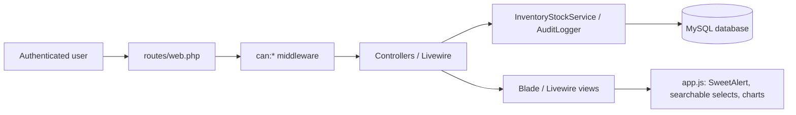
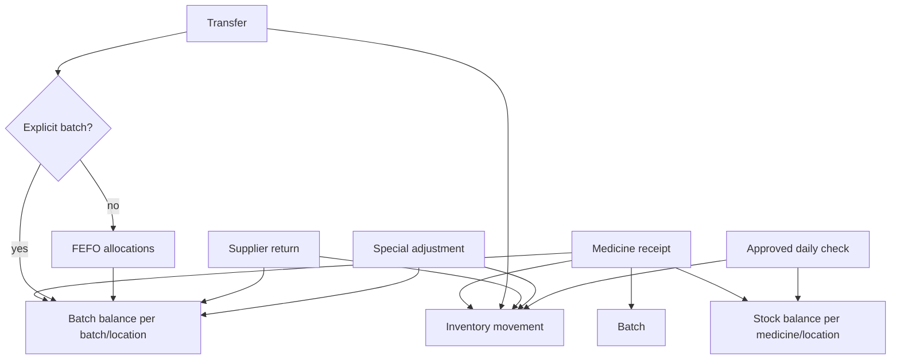

# Architecture

## Current Stack

- Backend: Laravel 13, PHP 8.3+
- UI: Blade, Livewire 3 for medicine master UI, Tailwind CSS 4
- Frontend build: Vite
- JavaScript libraries: Chart.js, SweetAlert2, Axios bootstrap
- Database: MySQL for app runtime; PHPUnit is configured for SQLite memory tests when `pdo_sqlite` is available
- Auth: Laravel session authentication with username/password

## Major Modules

- Auth/session: `SessionController`, `EnsureActiveAccount`
- Dashboard: `PrototypeController`
- Master medicine: `MedicineIndex`, `Medicine`, `Unit`, `MedicinePackage`, `MedicineAudit`
- Inventory: `InventoryController`, `InventoryStockService`
- Daily checks: `NightlyCheckController`
- Admin users/RBAC: `Admin\UserController`, `Permissions`, `Role`
- Audit log: `AuditLogger`, `AuditLog`, `Admin\AuditLogController`
- UI shell: `resources/views/components/layouts/app.blade.php`
- Frontend behavior: `resources/js/app.js`, `resources/css/app.css`
- Onboarding: `Onboarding`, `OnboardingController`, and Driver.js; targetless centered welcome followed by permission-filtered menu spotlights.
- Login password visibility: `resources/js/password-visibility.js`, initialized by `app.js`, using Lucide Eye/EyeOff without changing authentication.
- Error UI: standalone `resources/views/errors/{403,404,500}.blade.php` overrides and a shared layout, independent of Vite/database/session reads. Laravel still controls HTTP status, JSON negotiation, reporting, and debug output.

## Runtime Flow

## Inventory Data Flow

## Important Interfaces And Services

- `InventoryStockService::add()` updates aggregate stock per medicine/location with negative-stock protection.
- `InventoryStockService::addBatch()` updates batch stock per batch/location with negative-stock protection.
- `InventoryStockService::fefoAllocations()` chooses batch allocations ordered by expiry.
- `Permissions::roleCan()` checks RBAC permissions from `role_permissions` with defaults and locked admin permissions.
- `AuditLogger::record()` writes audit trail entries.
- `resources/js/app.js` owns searchable select behavior, dependent dropdowns, SweetAlert confirmations, and Chart.js setup.

## External Services

No external SaaS integration is currently wired into the runtime application. Composer/npm package registries are used for dependency installation. GitHub is used as source control.

## Storage And Database Behavior

- Local UAT uses a persistent separate MySQL schema and schema-limited database account via `scripts/uat.php`, without editing the main `.env`. `UatEnvironment` rejects unsafe UAT configuration during provider boot. Sessions/cache, files/views/logs and APP_KEY/cookie are isolated. See [UAT guide](uat_guide.md); the primary database remains the clinic environment.
- Guest is capped at operational read permissions, even if forbidden matrix rows are enabled. `view-monitoring-parameters` controls viewing; `manage-monitoring-parameters` controls updates. No guest access to administration/audit/references/settings.

- `users` stores staff/admin/guest accounts.
- `users.onboarding_seen_at` records completed/skipped first-login guides. The authenticated, active-account-only `POST /panduan/selesai` updates the current account only; this endpoint does not grant inventory permissions. Driver.js displays steps derived from backend RBAC and menu elements, with no inventory writes.
- `role_permissions` stores RBAC matrix values.
- `medicines`, `units`, `medicine_packages`, and related tables store master medicine metadata.
- `stock_balances` stores current aggregate stock by medicine/location.
- `batch_stock_balances` stores current batch stock by medicine/batch/location.
- `inventory_movements` stores stock movement history.
- `inventory_receipts` and `inventory_receipt_items` store receipt documents and line items.
- `nightly_checks` and `nightly_check_items` store daily stock check workflow.
- `audit_logs` stores administrative/activity audit events.

## Security/Privacy-Relevant Behavior

- Passwords are hashed by Laravel model casting.
- Role permissions are enforced through route middleware.
- Inactive accounts are blocked by middleware.
- Audit logs include actor, role, IP address, user agent, event, description, and metadata.
- Demo password is intentionally not documented in README.

